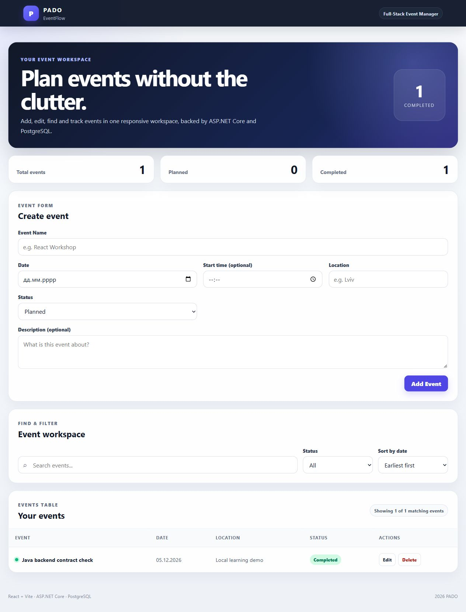

# Actual verification on 6 November 2026

Environment: Windows, Eclipse Temurin 21.0.13, Maven 3.10.0, PostgreSQL 17.11 on loopback. Separate disposable databases were used for integration and manual demo execution. No system Java version or existing user database was changed.

| Command or check | Actual result |
| --- | --- |
| `mvn --batch-mode --no-transfer-progress test` | BUILD SUCCESS; 6 unit tests, 0 failures/errors/skips |
| `mvn --batch-mode --no-transfer-progress -Pintegration verify` | BUILD SUCCESS; 6 unit tests + 9 real HTTP/PostgreSQL integration tests, 0 failures/errors/skips |
| `java -jar target/java-eventflow-1.0.0.jar` with DB environment variables | Packaged JAR started successfully on 127.0.0.1:5080; Flyway migration and Hibernate validation passed |
| Existing React/Vite client, unchanged source | Created an event through the form, displayed the persisted result and completed it; statistics changed from planned to completed |
| Schema constraint | Direct SQL blank-name write rejected by PostgreSQL in the integration test |
| Error routing | Unknown route 404, unsupported method 405, malformed query/body 400 verified over HTTP |
| Dependency tree and POM license metadata | Generated successfully; 94 direct/transitive runtime/test dependencies inventoried |
| Docker image and Compose | NOT RUN: Docker is not installed in this environment |
| Hosted GitHub Actions | NOT RUN: prepared workflow; repository not remotely published |

The first integration attempt failed because the new test database had not yet been created. The setup was corrected, and the final full profile passed. A subsequent protocol-error test caught the need to preserve Spring's HTTP error status in the generic exception handler; the final run includes that correction. None of those failed attempts are represented as passing runs.

Surefire and Failsafe reports are produced under `target/` when the commands run. Mockito emitted its Java-agent warning during the isolated mock-based tests; this did not fail the build. No claim of zero runtime warnings, performance testing or production readiness is made.

## React compatibility evidence

The screenshot below is the original React UI calling the packaged Java service and its separate PostgreSQL database. The frontend's static ASP.NET Core labels were intentionally unchanged during the compatibility check; they describe the original UI project, not the backend running for this check.

